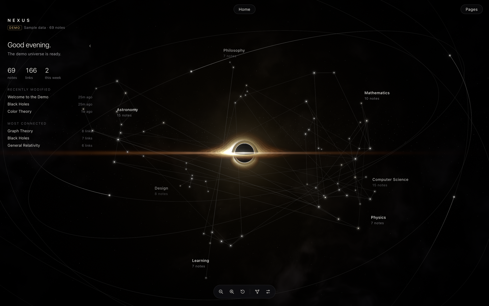
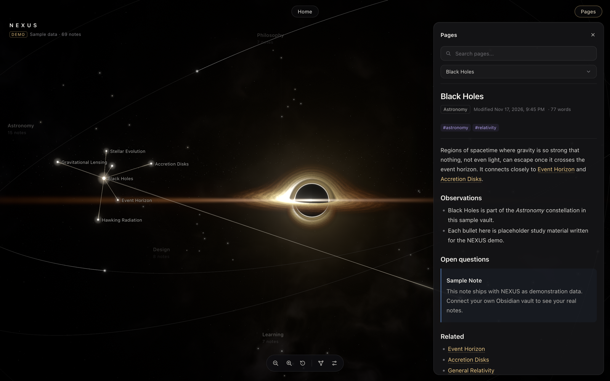
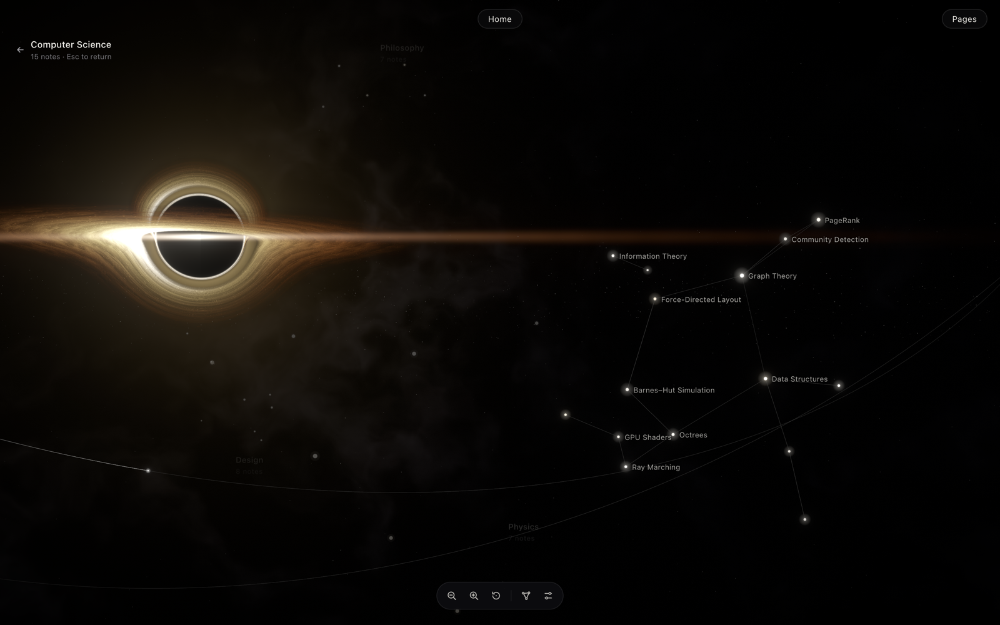
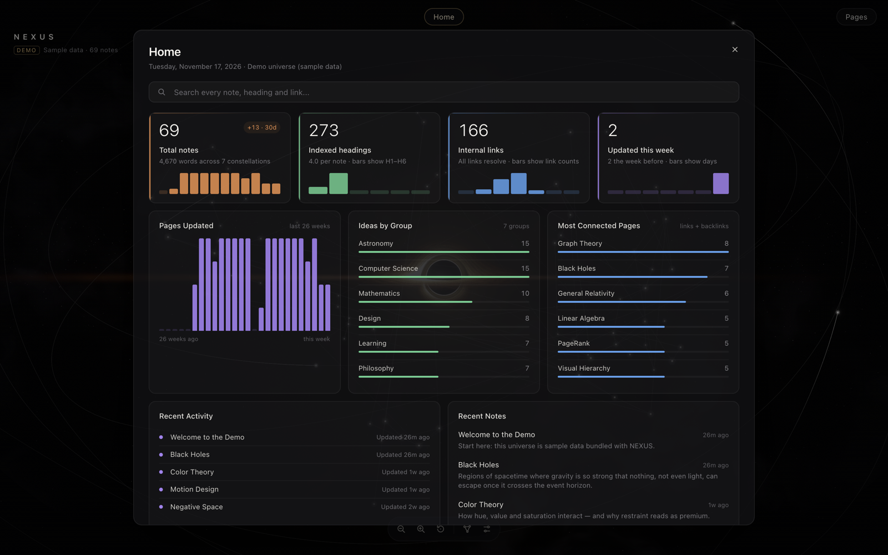

# NEXUS

**A cinematic, local-first knowledge universe for your Obsidian vault.**

NEXUS turns an Obsidian vault into an explorable universe: every Markdown note is a star, every internal link is a hairline connection, folders become constellations, and a ray-marched black hole sits at the centre of it all. It is a native-feeling macOS app (Electron, Apple Silicon) that works entirely offline and never modifies your notes.



| Note panel | Constellation focus | Home dashboard |
|---|---|---|
|  |  |  |

*Screenshots show the bundled demo universe (sample data).*

---

## Requirements

| | |
|---|---|
| Run | macOS 12 or later (tested on macOS 26 Tahoe), Apple Silicon (arm64) |
| Build | Node.js 22.12+ (developed with Node 26), npm 10+, Xcode command-line tools (for `iconutil`/`codesign`) |

## Quick start

```bash
npm install
```

```bash
npm run dev
```

| Script | What it does |
|---|---|
| `npm run dev` | Electron + Vite dev server with hot reload |
| `npm run build` | Type-checks (main + renderer) and builds production bundles into `out/` |
| `npm run test` | Unit and integration tests (Vitest): parser, link resolver, indexer, watcher, layout, security, 5,000-note scale |
| `npm run test:e2e` | Builds, then runs the Playwright end-to-end suite against the built app |
| `npm run dist` | Builds `release/mac-arm64/NEXUS.app` and `release/NEXUS.dmg` (arm64, ad-hoc signed) |
| `npm run pack` | Builds only the `.app` (faster) |
| `npm run test:packaged` | Runs the same end-to-end suite against the packaged `NEXUS.app` |
| `npm run release:github` | Builds the hardened public release and writes upload-ready assets to `release/github/` |
| `npm run icons` | Regenerates the procedural app icon (`build/icon.png`, `build/icon.icns`) |
| `npm run demo-vault` | Regenerates the bundled demo vault (`resources/demo-vault`) |

### Installing the app

Open `release/NEXUS.dmg` and drag **NEXUS** to Applications. Local builds are ad-hoc signed and not notarized. A build made on this Mac opens normally. If you copy the DMG to another Mac, Gatekeeper will block it until it is signed and notarized (see [Code signing and notarization](#code-signing-and-notarization)). For your own testing, Control-click the app and choose **Open**.

## Using NEXUS

1. On first launch choose **Connect Obsidian Vault** and pick your vault folder in the native dialog. You can also explore the **demo universe**. Its 69 sample notes are always labelled *Demo · Sample data*.
2. The vault is indexed and laid out, and the universe appears. Positions are cached, so the constellation looks the same every time you open it.
3. Edit notes in Obsidian as usual. New, changed, renamed and deleted notes update the universe within a fraction of a second.

### Navigation

| Action | Result |
|---|---|
| Hover a star | Brightens it, shows its connections and a tooltip |
| Click a star | Focuses the camera, highlights radiating links, opens the note panel |
| Double-click a star | Opens the note in Obsidian |
| Click a constellation label | Cinematic move into that constellation (black hole shifts left) |
| Drag | Orbit the camera |
| Right-drag, or Shift/Option-drag | Pan |
| Scroll / pinch | Zoom; horizontal two-finger swipe orbits |
| **Home** button | Returns to the full universe and opens the analytics dashboard |
| **Pages** button | Opens the note explorer panel |

### Keyboard shortcuts

| Shortcut | Action |
|---|---|
| ⌘K (or `/`) | Search every note, heading, tag and link. Use ↑↓ to move, ↵ to open, Esc to close |
| ⌘O | Open or change vault |
| ⌘R | Refresh the vault index (it does **not** reload the window) |
| ⌘0 | Reset camera |
| ⌘, | Settings |
| ⌘1 / ⌘2 | Home dashboard / Pages |
| ⌘= / ⌘− | Zoom in / out |
| ⌘L | Toggle connections |
| ⌃⌘F | Full screen |
| Esc | Close the top-most overlay, then deselect, then leave the constellation |

## Privacy and security

* **Offline by design.** No telemetry, analytics, accounts or remote APIs. The renderer's session blocks every request that is not local app content, and a strict Content-Security-Policy forbids remote scripts, styles, images and connections. Remote images in notes are shown as a placeholder and never fetched.
* **Read-only.** The vault is only ever opened for reading. No metadata or cache files are written into it; tests hash the whole vault before and after to prove it.
* **Data location.** Settings, window state and the layout cache (star positions keyed by note path, but no note content) live in `~/Library/Application Support/NEXUS/`. *Settings → Clear local cache* removes the cache.
* **Electron hardening.** The renderer runs with `contextIsolation`, the sandbox on, and `nodeIntegration` off. It has no filesystem access. A small typed preload API exposes narrowly scoped IPC calls. Every handler checks the sender frame and validates its arguments.
* **Path safety.** Note reads go through a guard that rejects traversal and absolute paths. It refuses symbolic links at every path segment and checks that the real path is still inside the vault. Indexing and watching never follow symlinks.
* **Safe Markdown.** Raw HTML in notes is not rendered, so scripts cannot run. Executable (`---js`) front matter is disabled, and that code path is removed from the bundle at build time. Only `http(s)`/`mailto` links can be opened externally, after you click them.
* **Electron fuses.** `runAsNode` and `NODE_OPTIONS` are off, cookie encryption is on, and the app loads only from the asar. Release builds also disable `--inspect` (see below).

## Architecture

```
src/
  main/                      Electron main process (Node)
    index.ts                 app lifecycle, window, security policy, layout worker pool
    electron/                native menu, Obsidian URI builder, read-only image protocol
    ipc/handlers.ts          validated IPC surface
    vault/vaultService.ts    owns the connected vault: index ↔ watcher ↔ layout ↔ snapshots
    indexing/                markdown-it parser, Obsidian link resolver, categories, search
    filesystem/              discovery (no symlinks), path guard, debounced chokidar watcher
    layout/                  deterministic d3-force-3d layout (worker thread) + position cache
    settings/                JSON settings store (atomic writes)
  preload/index.ts           contextBridge API (`window.nexus`)
  renderer/src/
    components/universe/     the WebGL universe (React Three Fiber)
      blackhole/             ray-marched black hole billboard
      stars/                 stars, hairline connections, radiating highlights (two depth passes)
      atmosphere/            nebula (low-res offscreen), dust, orbital arcs
      camera/                cinematic orbit rig with eased transitions and off-axis framing
      labels/                DOM labels, note labels and tooltip positioned per frame
      scene/                 frame driver, picking/interaction, post-processing
      Director.tsx           maps UI state → camera moves and emphasis
    components/overlays/     top bar, toolbar, briefing, onboarding/empty/error states, note panel
    components/dashboard/    Home analytics
    components/search/       ⌘K palette and search hook
    components/settings/     settings overlay
    components/markdown/     safe Markdown rendering + Obsidian remark plugin
    lib/graphModel.ts        typed arrays shared with GPU buffers (no React per frame)
  shared/                    types, IPC channel names, validation
  shaders/                   GLSL: black hole, nebula, stars, edges, orbits, dust, noise
tests/
  fixtures/test-vault/       automated test vault (folders, wikilinks, aliases, duplicates, unicode, symlink, .obsidian)
  unit/                      Vitest
  e2e/                       Playwright for Electron (dev build or packaged app)
```

### Data flow

1. **Index.** `VaultService` discovers notes, parses them with markdown-it (code blocks and comments can never produce links), and resolves links the way Obsidian does. Resolution checks the vault path, then the path relative to the note, then the closest exact basename, then a unique frontmatter alias. It never fuzzy-matches.
2. **Categorise.** The order is frontmatter `category`, then folder, then a root note's linked neighbours, then a shared tag. A flat vault falls back to label-propagation communities. There are at most 16 constellations.
3. **Lay out.** A seeded d3-force-3d simulation runs in a worker thread and places notes in a flattened spherical shell around the black hole. Each category gets its own anchor direction, kept clear of the default line of sight. Cached stars are pinned, so only new or re-categorised stars move, and they glide to their new place.
4. **Watch.** Chokidar events are coalesced, and the disk is re-checked at flush time. This makes rapid saves and atomic replace-on-save robust. Renames are detected by inode, so a renamed star keeps its position.
5. **Render.** The renderer gets a lightweight snapshot (metadata, edges, positions). Note content is fetched on demand and never cached to disk.

### Rendering notes

* **Black hole.** A camera-facing billboard ray-marches each pixel through an approximation of the Schwarzschild photon equation, `x'' = −1.5 h² x / |x|⁵`. Where a ray crosses the disk plane, a procedural accretion disk is shaded with Keplerian flow, relativistic beaming and gravitational redshift. Its texture uses cross-faded flow phases so it never winds up. This naturally yields the dark shadow, the lensed arc over the top, the secondary image below, the photon ring, and the bright band crossing the horizon. A thin horizontal light structure and a filmic shoulder complete the look. Step count scales with quality and on-screen size.
* **Depth without depth buffers.** Stars and connections are drawn in two passes, one behind the black hole and one in front. The event horizon therefore hides what is behind it, and stars in front of it are softened so it stays the focal point.
* **Stars.** All stars are drawn as one GPU point cloud with per-star size, brightness, emphasis, hover and birth attributes. Hit-testing is done in screen space, which handles thousands of 1–3 px stars precisely.
* **Nebula.** Domain-warped simplex fbm, rendered at ⅕–⅓ resolution into a half-float target, then upsampled with dithering.
* **Performance.** Quality presets (High, Balanced, Performance) control pixel ratio, MSAA, bloom, ray-march steps, noise octaves and dust density. An adaptive resolution loop lowers the pixel ratio when the frame rate drops. Rendering pauses while the window is hidden or minimised.

Measured on this Apple Silicon Mac: 5,000 notes index in about 0.35 s and lay out the first time in about 5 s (cached afterwards). Search takes under 10 ms. The 5,000-note universe renders at 120 fps on a ProMotion display.

## Testing

`npm run test` runs 40 Vitest tests. `npm run test:e2e` / `npm run test:packaged` run 20 Playwright tests against the real Electron app (dev build or the packaged `NEXUS.app`), driving real mouse and keyboard input. The automated checks map to the acceptance criteria:

| Criterion | Where |
|---|---|
| One star per note, none extra | `indexer.test.ts`, `e2e/nexus.spec.ts` |
| Every valid link → expected edge; unresolved/fuzzy/code links ignored | `resolver.test.ts`, `parser.test.ts`, `indexer.test.ts`, e2e |
| Unlinked notes remain | `indexer.test.ts`, e2e |
| Clicking a star opens the correct note | e2e (real mouse click on the projected star) |
| Open in Obsidian targets the correct file (URI + double-click) | `security.test.ts`, e2e |
| Create / modify / rename / delete update the universe | `vaultService.test.ts`, e2e |
| Search finds the correct notes | `indexer.test.ts`, e2e (⌘K, arrows, Return, Esc) |
| Category selection animates the camera smoothly | e2e (samples intermediate camera frames) |
| Black hole visible behind overlays | e2e (pixel sampling next to the note panel) |
| Dashboard shows real data | e2e (13 notes / 15 headings / 14 links for the fixture) |
| Works offline | e2e (all requests are `file:`/`data:`/`blob:`), session request blocking |
| Notes unchanged | `indexer.test.ts`, e2e (SHA-256 of every vault file before/after) |
| Packaged app runs without a dev server | `npm run test:packaged` (asserts the page loads from `app.asar`) |
| Path traversal / symlinks rejected, settings validated | `security.test.ts` |
| Scale: 5,000 notes | `scale.test.ts`, `e2e/states.spec.ts` |

## Publishing a GitHub release

```bash
npm run release:github
```

This builds the app in hardened mode, with every debugging fuse off and an ad-hoc signature. It then verifies the app, the app inside the DMG and the app inside the ZIP, and writes these files to `release/github/`:

| File | Purpose |
|---|---|
| `NEXUS-<version>-arm64.dmg` | Installer (drag to Applications) |
| `NEXUS-<version>-arm64.zip` | Same app as a zip, made with `ditto` so the signature survives |
| `SHA256SUMS.txt` | Checksums |
| `RELEASE_NOTES.md` | Ready-to-paste release description, including first-launch instructions |

To publish, on GitHub open **Releases → Draft a new release**. Create a tag such as `v1.0.0`, paste `RELEASE_NOTES.md` into the description, attach the DMG, the ZIP and `SHA256SUMS.txt`, and publish. Bump `version` in `package.json` before building the next release.

Because these builds are not notarized, people who download them must allow the first launch in **System Settings → Privacy & Security → Open Anyway**. The release notes explain this. Notarizing removes that step (see the next section).

## Code signing and notarization

Local builds use an ad-hoc signature (`mac.identity: "-"`), which is enough to run on the Mac that built them. To distribute NEXUS:

1. Install a **Developer ID Application** certificate in your login keychain. Alternatively, set `CSC_LINK` (a .p12 file) and `CSC_KEY_PASSWORD`, or `CSC_NAME` to choose an identity.
2. Provide notarization credentials. Use either an App Store Connect API key (`APPLE_API_KEY`, `APPLE_API_KEY_ID`, `APPLE_API_ISSUER`) or an Apple ID (`APPLE_ID`, `APPLE_APP_SPECIFIC_PASSWORD`, `APPLE_TEAM_ID`).
3. Build with `NEXUS_RELEASE=1`:

   ```bash
   NEXUS_RELEASE=1 npm run dist
   ```

   This turns on the hardened runtime, notarization and stapling. It also disables the `--inspect` fuse (so `test:packaged` cannot attach to release builds). electron-builder's default Electron entitlements (JIT, unsigned executable memory) are used.
4. Verify:

   ```bash
   spctl -a -vvv -t install release/mac-arm64/NEXUS.app
   ```

## Limitations

* NEXUS is a read-only explorer. Editing happens in Obsidian.
* Gravitational lensing is a stylised, physically inspired approximation. It bends light from the accretion disk but not from the constellation behind it.
* Embedded images (`![[image.png]]`) are previewed from the vault. New image files added while NEXUS is running appear after ⌘R.
* Embeds of other notes are shown as links rather than inlined.
